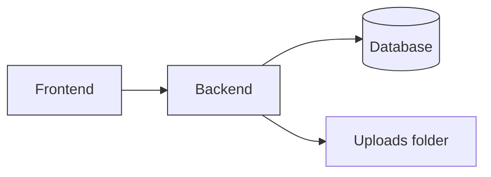
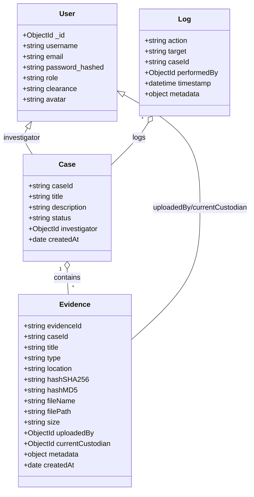

# ChainGuard (HashGuard)

> Secure evidence & case management — backend API + Expo front-end

## About

ChainGuard (a.k.a. HashGuard) is a lightweight evidence and case management system designed to help investigators securely collect, store, and transfer digital and physical evidence while maintaining a clear audit trail. The project focuses on:

- Chain of custody for evidence with explicit transfer actions and custody tracking.
- Tamper-evident evidence records (file uploads + hash metadata).
- Role-based access and audit logging for accountability.
- Mobile-first UI built with Expo + `expo-router` for on-the-go data collection.

This repository contains a simple, opinionated implementation intended for prototyping and internal tooling rather than a hardened production deployment.

## Quick Links

- Backend entry: `Backend/server.js`
- Frontend entry: `Frontend/app`
- Seed admin user: `Backend/seed.js`

## Features

- User authentication (JWT)
- Case creation and status management (archive/unarchive)
- Evidence upload, metadata (SHA256/MD5), and custody transfer
- Audit logs and login history
- File uploads served from `Backend/uploads`

## Architecture (high level)



### Data Models (detailed)



Note: These diagrams are provided as Mermaid markup — they render on platforms that support Mermaid (e.g., GitHub, GitLab, certain static site generators). You can export diagrams as images using a Mermaid CLI or editor.

## Getting Started

Prerequisites

- Node.js (Frontend requires Node >= 20 per `Frontend/package.json`)
- npm (or yarn)
- MongoDB (local or hosted)

Environment

Create `Backend/.env` with at least:

```
mongo_db_url=mongodb://localhost:27017/chainguard
JWT_SECRET=your_jwt_secret
PORT=5000
```

Backend

```bash
cd Backend
npm install
# seed optional admin user
node seed.js
# development
npm run dev
```

Frontend (Expo)

```bash
cd Frontend
npm install
npm start
```

If you run the frontend locally and need to point to a non-local backend, update `Frontend/utils/api.ts` base URL.

## API Overview (selected endpoints)

- `POST /api/auth/register` — register user
- `POST /api/auth/login` — login and receive JWT
- `GET /api/cases` — list cases
- `POST /api/cases` — create case (auth)
- `POST /api/evidence` — upload evidence (auth, multipart form)
- `PUT /api/evidence/:id/transfer` — transfer custody (auth)

Refer to `Backend/server.js` for full route definitions and request shapes.

## Security & Deployment Notes

- Do not commit `.env` or secrets. Use environment variables or a secrets manager in production.
- Consider using object storage (S3/GCS) for uploads in production rather than local filesystem.
- Add HTTPS, strong JWT secrets, rate limiting, and input validation for production readiness.

## Contributing

- Open issues for bugs or feature requests.
- Create PRs against a feature branch; include tests where applicable.

## License

See the repository license file: [Frontend/LICENSE](Frontend/LICENSE) or [LICENSE](LICENSE) if present.

